# Touka 系統架構圖 (System Architecture)

```mermaid
graph TB
    %% ═══════════════════════════════════════════════════════════════
    %% 1. 外部層 (External)
    %% ═══════════════════════════════════════════════════════════════
    subgraph EXTERNAL ["🌐 外部層 (External)"]
        direction LR
        browser["🖥️ Browser<br/>Port 3001"]
        vscode["💻 VS Code IDE<br/>ToukaIDE Extension"]
        external_ai["🤖 External AI Tools<br/>Claude Code / Aider"]
    end

    %% ═══════════════════════════════════════════════════════════════
    %% 2. 服務層 (Services)
    %% ═══════════════════════════════════════════════════════════════
    subgraph SERVICES ["⚙️ 服務層 (Services)"]
        direction LR
        chat["ToukaChat<br/>React + Next.js<br/>Port 3001"]
        proxy["ToukaProxy<br/>FastAPI 核心閘道<br/>Port 8000"]
        heartbeat["ToukaHeartbeat<br/>脈衝排程器<br/>Port 8082"]
        memory["ToukaMemory<br/>整合式 Python 模組<br/>記憶 / 檔案庫 / 看板"]
        dispatch["ToukaDispatch<br/>任務派發 MCP 伺服器<br/>/mcp 主路徑＋/sse 相容窗<br/>Port 8083（ADR-0082／0201）"]
    end

    %% ═══════════════════════════════════════════════════════════════
    %% 3. ToukaProxy 內部層 (Internal)
    %% ═══════════════════════════════════════════════════════════════
    subgraph PROXY_INTERNAL ["🔧 ToukaProxy 內部層 (Internal Pipelines)"]

        subgraph MIDDLEWARE ["🛡️ Middleware"]
            direction LR
            mw_sec["SecurityHeaders<br/>X-Content-Type / X-Frame / Referrer"]
            mw_size["RequestSizeLimit<br/>10MB Guard"]
            mw_cors["CORS Middleware"]
        end

        subgraph ROUTERS ["🚏 Routers (24)"]
            direction LR
            r_auth["auth<br/>登入/註冊/刷新"]
            r_proxy["proxy<br/>主對話流"]
            r_heartbeat["heartbeat<br/>awaken 喚醒"]
            r_terminal["terminal<br/>SSE 串流/審核"]
            r_editor["editor<br/>檔案讀取"]
            r_mcp["mcp<br/>MCP Hub/配置"]
            r_debug["debug<br/>診斷執行"]
            r_admin["admin<br/>使用者管理"]
            r_models["models<br/>模型管理"]
            r_souls["souls<br/>靈魂管理"]
            r_system["system<br/>滑動視窗/狀態"]
            r_connections["connections<br/>自定義連線"]
            r_ui_sessions["ui_sessions<br/>會話管理"]
            r_observability["observability<br/>日誌/健康檢查"]
            r_identity["identity<br/>身分映射"]
            r_permissions["permissions<br/>權限配置"]
            r_autonomy["autonomy<br/>自主預算"]
            r_skills["skills<br/>技能管理"]
            r_creation["creation<br/>skill/MCP 創建"]
            r_bots["bots<br/>SNS 機器人"]
            r_custom_models["custom_models<br/>L2 自定義"]
            r_stats["stats<br/>統計數據"]
            r_group["group_settings<br/>群聊設定"]
            r_settings["settings<br/>全域設定"]
        end

        subgraph SERVICES_INTERNAL ["🧠 Services"]
            direction LR
            sv_auth["AuthService<br/>JWT + Bcrypt"]
            sv_identity["IdentityRouter<br/>身分路由/糾偏"]
            sv_permission["PermissionService<br/>RBAC + ABAC"]
            sv_autonomy["AutonomyService<br/>脈衝預算"]
            sv_resource["ResourceManager<br/>路徑定址/IO代理"]
            sv_rhythm["RhythmService<br/>ReAct 循環"]
            sv_session["SessionService<br/>async_db"]
            sv_model["ModelManager<br/>模型發現/健康"]
            sv_kb["KnowledgeBaseService<br/>向量記憶橋接"]
        end

        subgraph TOOLS ["🛠️ Tools"]
            direction LR
            t_terminal["terminal<br/>Bash 執行器"]
            t_editor["editor<br/>IDE 檔案操作"]
            t_evolution["evolution<br/>自主演化沙箱"]
            t_mission["mission_tools<br/>任務看板"]
            t_memory["memory_tools<br/>長期記憶"]
            t_vault["vault_tools<br/>檔案庫"]
            t_project["project_tools<br/>專案管理"]
            t_agent_control["agent_control<br/>模型切換"]
        end

    end

    %% ═══════════════════════════════════════════════════════════════
    %% 4. 資料層 (Data)
    %% ═══════════════════════════════════════════════════════════════
    subgraph DATA ["💾 資料層 (Data Layer)"]
        direction LR
        
        subgraph SQLITE ["SQLite"]
            ui_db["ui_sessions.db<br/>對話會話"]
            legacy_db["legacy_history.db<br/>舊對話存儲庫"]
            user_sessions["user_sessions<br/>Session TTL"]
        end

        subgraph QDRANT ["Qdrant"]
            vector["向量記憶<br/>長期記憶嵌入"]
        end

        subgraph JSON ["JSON SSOT 配置"]
            users["users.json<br/>人類帳號/擁有權"]
            models["models.json<br/>模型註冊表"]
            identity_map["identity_map.json<br/>身分能力映射"]
            auth_policies["auth_policies.json<br/>黑名單與工具風險分類"]
            connections["connections.json<br/>自定義 API 連線"]
            errors["errors.json<br/>錯誤碼定義"]
            autonomy["autonomy.json<br/>全域自主預算"]
            sliding_window["sliding_window.json<br/>滑動視窗設定"]
            group_whitelist["group_whitelist.json<br/>群聊別名映射"]
        end

        subgraph FILESYSTEM ["File System"]
            soul_dir["data/soul/{id}<br/>靈魂腳本"]
            custom_dir["data/custom/{id}<br/>L2 自定義模型"]
            personal_dir["data/personal/{id}<br/>個人磁碟/看板"]
            legacy_dir["data/legacy/{id}<br/>舊對話紀錄"]
            stats_dir["data/stats/{id}<br/>統計數據"]
            logs_dir["data/logs/{id}<br/>系統日誌"]
        end
    end

    %% ═══════════════════════════════════════════════════════════════
    %% 5. LLM 外部 API
    %% ═══════════════════════════════════════════════════════════════
    subgraph LLM ["☁️ 外部 LLM API"]
        openai["OpenAI / Ollama / xAI<br/>Claude / Gemini / Grok"]
    end

    %% ═══════════════════════════════════════════════════════════════
    %% 關鍵流程線 (Key Flow Lines)
    %% ═══════════════════════════════════════════════════════════════

    %% ── 外部到服務 ──
    browser --> chat
    vscode --> proxy
    external_ai -->|"🔧 MCP Streamable HTTP<br/>/mcp（主）／/sse（相容）<br/>Port 8083"| dispatch

    %% ── 認證流 (Auth Flow) ──
    chat -->|"🔐 Login / Register"| r_auth
    r_auth -->|"JWT 簽發"| sv_auth
    sv_auth -->|"讀寫"| users

    %% ── 對話流 (Chat Flow) ──
    chat -->|"💬 fetchTouka()<br/>POST /v1/proxy/chat"| r_proxy
    r_proxy -->|"路由"| sv_identity
    sv_identity -->|"驗證身分"| sv_auth
    sv_identity -->|"注入 AgentIdentity"| sv_rhythm
    sv_rhythm -->|"ReAct 循環"| sv_autonomy
    sv_rhythm -->|"調用工具"| t_memory
    sv_rhythm -->|"調用 LLM"| openai
    openai -->|"SSE Streaming"| proxy

    %% ── 脈衝流 (Heartbeat Flow) ──
    heartbeat -->|"💓 POST /heartbeat/awaken<br/>X-Heartbeat-Token"| r_heartbeat
    r_heartbeat -->|"驗證 service JWT"| sv_auth
    r_heartbeat -->|"檢查預算"| sv_autonomy
    r_heartbeat -->|"觸發喚醒"| sv_rhythm

    %% ── MCP 工具流 ──
    memory -->|"工具調用"| t_vault
    memory -->|"工具調用"| t_memory
    memory -->|"工具調用"| t_mission
    memory -->|"get_resource_proxy()"| sv_resource
    
    dispatch -->|"任務看板 (FSM)"| t_mission
    dispatch -->|"get_resource_proxy()"| sv_resource

    %% ── 內部路由到服務 ──
    r_proxy --> sv_identity
    r_terminal --> sv_session
    r_editor --> sv_resource
    r_mcp --> sv_permission
    r_debug --> sv_permission
    r_admin --> sv_auth
    r_models --> sv_model
    r_souls --> sv_resource
    r_system --> sv_session
    r_observability --> sv_kb
    r_identity --> sv_identity
    r_permissions --> sv_permission
    r_autonomy --> sv_autonomy
    r_custom_models --> sv_resource
    r_stats --> sv_session
    r_creation -->|"Owner/admin 創建"| sv_identity

    %% ── Middleware 攔截鏈 ──
    mw_sec -.->|"每個請求"| proxy
    mw_size -.->|"每個請求"| proxy
    mw_cors -.->|"每個請求"| proxy

    %% ── 工具到資料 ──
    t_memory -->|"寫入/查詢"| vector
    t_memory -->|"事實存儲"| SQLITE
    t_vault -->|"讀寫檔案"| personal_dir
    t_vault -->|"讀取舊對話"| legacy_dir
    t_vault -->|"讀取靈魂"| soul_dir
    t_mission -->|"任務持久化"| personal_dir
    t_evolution -->|"沙箱產出"| personal_dir
    t_terminal -->|"審計日誌"| stats_dir
    t_agent_control -->|"切換模型"| models

    %% ── 服務到資料 ──
    sv_session -->|"讀寫"| ui_db
    sv_session -->|"讀寫"| legacy_db
    sv_session -->|"管理"| user_sessions
    sv_model -->|"讀寫"| models
    sv_permission -->|"讀取"| auth_policies
    sv_permission -->|"讀取"| identity_map
    sv_autonomy -->|"讀取"| autonomy
    sv_resource -->|"路徑定址"| soul_dir
    sv_resource -->|"路徑定址"| custom_dir
    sv_resource -->|"路徑定址"| personal_dir
    sv_resource -->|"路徑定址"| legacy_dir
    sv_auth -->|"讀寫"| users
    sv_kb -->|"查詢"| vector

    %% ── 配置檔案 ──
    r_connections -->|"讀寫"| connections
    r_group -->|"讀寫"| group_whitelist
    r_system -->|"讀寫"| sliding_window

    %% ═══════════════════════════════════════════════════════════════
    %% 樣式 (Styles)
    %% ═══════════════════════════════════════════════════════════════
    classDef external fill:#e1f5fe,stroke:#0288d1,stroke-width:2px,color:#01579b
    classDef service fill:#f3e5f5,stroke:#7b1fa2,stroke-width:2px,color:#4a148c
    classDef middleware fill:#fff3e0,stroke:#e65100,stroke-width:2px,color:#bf360c
    classDef router fill:#e8f5e9,stroke:#2e7d32,stroke-width:1px,color:#1b5e20
    classDef service_int fill:#fce4ec,stroke:#c62828,stroke-width:2px,color:#880e4f
    classDef tool fill:#fff8e1,stroke:#f9a825,stroke-width:2px,color:#f57f17
    classDef sqlite fill:#e0f2f1,stroke:#00695c,stroke-width:2px,color:#004d40
    classDef qdrant fill:#e8eaf6,stroke:#283593,stroke-width:2px,color:#1a237e
    classDef json fill:#f1f8e9,stroke:#558b2f,stroke-width:2px,color:#33691e
    classDef filesys fill:#efebe9,stroke:#4e342e,stroke-width:2px,color:#3e2723
    classDef llm fill:#eceff1,stroke:#37474f,stroke-width:2px,color:#263238

    class browser,vscode,external_ai external
    class chat,proxy,heartbeat,memory,dispatch service
    class mw_sec,mw_size,mw_cors middleware
    class r_auth,r_proxy,r_heartbeat,r_terminal,r_editor,r_mcp,r_debug,r_admin,r_models,r_souls,r_system,r_connections,r_ui_sessions,r_observability,r_identity,r_permissions,r_autonomy,r_skills,r_creation,r_bots,r_custom_models,r_stats,r_group,r_settings router
    class sv_auth,sv_identity,sv_permission,sv_autonomy,sv_resource,sv_rhythm,sv_session,sv_model,sv_kb service_int
    class t_terminal,t_editor,t_evolution,t_mission,t_memory,t_vault,t_project,t_agent_control tool
    class ui_db,legacy_db,user_sessions sqlite
    class vector qdrant
    class users,models,identity_map,auth_policies,connections,errors,autonomy,sliding_window,group_whitelist json
    class soul_dir,custom_dir,personal_dir,legacy_dir,stats_dir,logs_dir filesys
    class openai llm
```

---

## 圖層說明

| 層級 | 顏色 | 內容 |
|------|------|------|
| 🌐 外部層 | 藍色 | Browser、VS Code IDE、外部 AI 工具（Claude Code、Aider 等） |
| ⚙️ 服務層 | 紫色 | ToukaChat、ToukaProxy、ToukaHeartbeat、ToukaMemory、ToukaDispatch |
| 🛡️ Middleware | 橘色 | SecurityHeaders、RequestSizeLimit、CORS |
| 🚏 Routers | 綠色 | 24 個 FastAPI Router |
| 🧠 Services | 紅色 | 9 個核心服務 |
| 🛠️ Tools | 黃色 | 8 個領域工具 |
| 💾 資料層 | — | SQLite / Qdrant / JSON SSOT / File System |
| ☁️ LLM API | 灰色 | OpenAI / Ollama / xAI / Claude / Gemini |

## 關鍵流程線

- **🔐 認證流**：`Chat → /auth/login → AuthService → users.json`
- **💬 對話流**：`Chat → /proxy/chat → IdentityRouter → RhythmService → LLM API → SSE`
- **💓 脈衝流**：`Heartbeat → /heartbeat/awaken → AutonomyService → RhythmService`
- **🔧 記憶工具流（整合模式）**：`ToukaProxy ToolExecutor → ToukaMemory Python 模組 → ResourceManager`；ToukaMemory 不再對外提供 standalone MCP。
- **📋 任務派發流 (外部協作)**：`Touka Agent → dispatch_initialize_mission(auto_invoke) → ToukaDispatch 依 dispatch_hooks.json 白名單 subprocess 召喚 External AI → External AI (Claude Code/Aider) → ToukaDispatch /mcp（legacy 可明示 /sse）→ 逐 request session digest/transport/method/generation 驗證 → MissionManager（看板讀寫與 FSM）`（ADR-0064／0067／0201）

> 本圖由 ADR-0001（脈衝驅動架構）出發，依循 SSOT_MASTER_MAP.md 及 PROXY_INTERFACE.md 等合約文件繪製。圖上 Router 共 24 個（含 ADR-0069 創建路由 `creation`；ADR-0254 刪掉沒有掛載的 `scheduler`），完整清單以 `main.py` 的 `CORE_ROUTERS`／`APP_ROUTERS` 為準，`endpoint_auth_allowlist.py` 祖父清單已清零。
